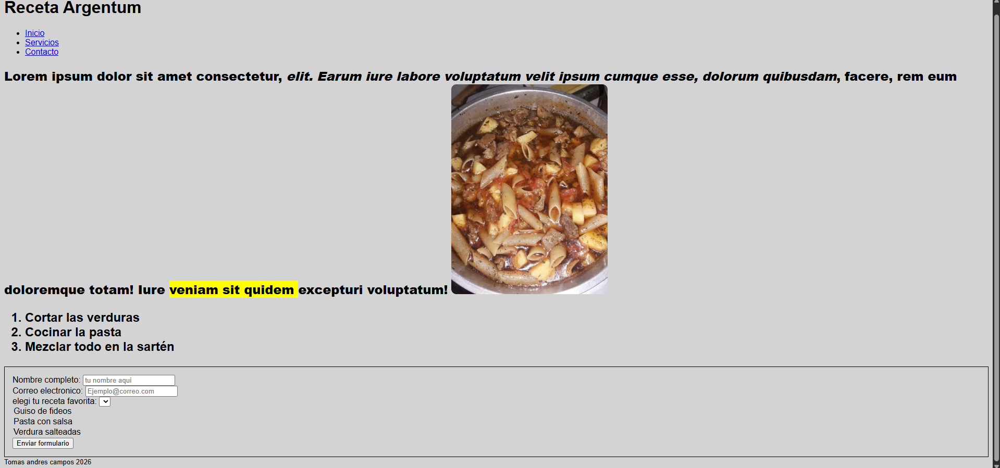

 ¿De que trata este proyecto?
Es una pagina estatica con tematica de receta Argentina y en este caso solo puse de receta santiagueña el guiso con varios pasos que explica como cocinar hacer el guiso que esta echo con la etiqueta ol que enumera pasos y acompañado con una estetica de fondo de css vinculado 

 Como abrir la pagina en tu computadora
Clonar el proyecto:Abri tu consola de Git y escribi este comando:
   bash
   git clone https://github.com/campostomas890-cmd/progrso_react_js.git
   
Abrir la web: Entra a la carpeta que te descargo, busca el archivo `index.html` y dale doble clic. Se va a abrir sola en tu navegador de internet.

Foto de la pagina terminada
foto de mi pagina web

la informacion de los codigos se saco en la unidad de la utn
y la creacion de la pagina es propia 

autor de la pagina
Estudiante:Tomas Andres Campos
